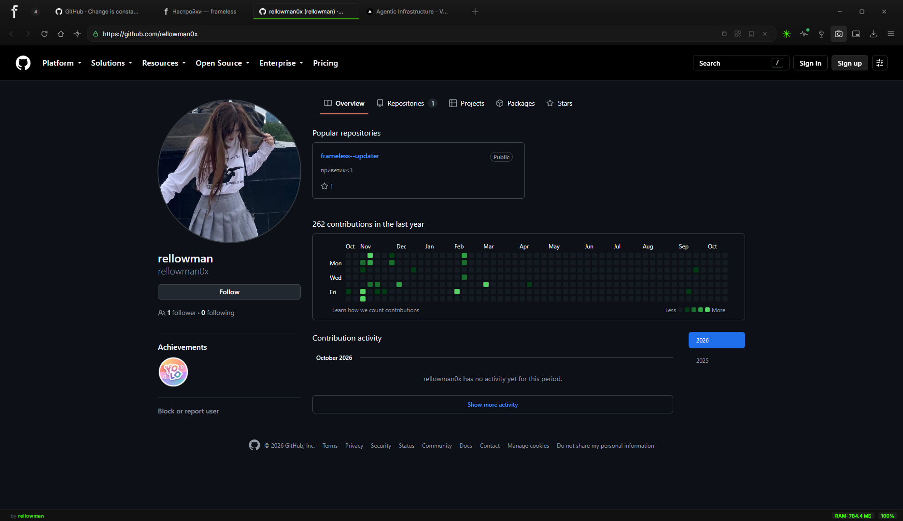

# frameless

**Быстрый, тёмный, минималистичный браузер для Windows.**
Chromium внутри. Визуальный шум — снаружи.

[**Скачать**](../../releases/latest) · [Скриншоты](#скриншоты) · [Возможности](#возможности) · [FAQ](#faq)

---

## Что это

**frameless** — браузер, собранный на Electron (Chromium). Тёмный интерфейс без визуального шума, вкладки, менеджер паролей под Windows Hello, блокировка рекламных кликандеров и автообновление прямо с GitHub. Бесплатно.

> ⚠️ **Проприетарное ПО.** Исходный код закрыт и не публикуется в этом репозитории — он используется только для релизов, документации и багрепортов. Лицензия: [см. ниже](#лицензия).

<table>
<tr>
<td width="50%">

**Минимализм**
Тонкие рамки, спокойные цвета, ничего не мелькает.

**Приватность**
Windows Hello для паролей, инкогнито без следов, ноль телеметрии.

**Скорость**
Движок Chromium и лёгкая оболочка — запуск мгновенный.

</td>
<td width="50%">

**Автообновление**
Проверка релизов при запуске и раз в 6 часов.

**И-ассистент**
GPT-4o, Whisper и голос Edge TTS — со своим ключом OpenAI.

**Перенос данных**
Закладки и настройки из Chrome и Яндекс.Браузера импортируются сами.

</td>
</tr>
</table>

## Установка

1. Открой [последний релиз](../../releases/latest).
2. Скачай **`frameless-Setup-1.2.0.exe`**.
3. Запусти установщик и следуй шагам мастера.

Дальше браузер обновляется сам — при запуске и раз в 6 часов. Ручное обновление тоже работает: просто поставь свежий релиз поверх старого.

> **Установщик не подписан цифровым сертификатом.** Defender, Kaspersky и другие антивирусы могут показать предупреждение — это ложное срабатывание. Качай `.exe` **только** из официальных релизов этого репозитория: чужие сборки ничем не проверены.

### Требования

| | |
|---|---|
| ОС | Windows 10 / 11 (x64) |
| macOS / Linux | не поддерживаются |
| Портативная версия | нет, только установщик NSIS |
| И-ассистент (опционально) | свой API-ключ OpenAI |

## Возможности

### Приватность и безопасность
- **Блокировка рекламных кликандеров** — сайты не открывают пустые вкладки по клику, рекламные домены режутся на уровне браузера.
- **Менеджер паролей** — сохранение и автозаполнение; пароли шифруются средствами Windows (DPAPI). Показ пароля защищён **Windows Hello** (лицо, отпечаток или PIN).
- **Инкогнито** — история, вкладки и загрузки не сохраняются.
- **Разрешения по-честному** — геолокация, а не «всем и молча».
- **Ноль телеметрии.**

### Работа с сетью
- **Прокси «из коробки»** — автоматически, системные настройки Windows, вручную или без прокси; HTTP и **SOCKS5**. Настройки применяются без перезапуска.
- **Школьные и корпоративные сети** — браузер уважает системный прокси и доверяет сертификатам, установленным в Windows.
- **Детектор прокси при запуске** — плашка «Включён прокси» с кнопкой автонастройки.

### Серфинг
- Вкладки (новые открываются рядом с текущей), закладки с папками, история, восстановление сессии.
- **Подсказки в адресной строке** — поисковик, история и закладки в одном списке.
- **Стартовая страница** — поиск с подсказками, погода и город.
- **Картинка в картинке (PiP)** — видео в плавающем окне поверх всех окон.
- **Загрузки** — своя папка, «Сохранить как» по желанию, превью картинок и видео.
- **Ограничение времени на сайты** — дневной лимит минут для выбранных адресов, раздел закрыт под Windows Hello.
- **Паки иконок** — встроенные и свои, плюс настройка цветов логотипа.
- **Импорт из Chrome и Яндекс.Браузера** при первом запуске.
- Страница настроек: `frameless://settings`.

### И-ассистент «МАУЗЕР» (опционально)
GPT-4o, распознавание речи (Whisper) и синтез голоса (Edge TTS). Работает только с твоим собственным ключом OpenAI и только пока ты им пользуешься.

## Горячие клавиши

| Клавиши | Действие | Клавиши | Действие |
|---|---|
| `Ctrl + T` | Новая вкладка | `Ctrl + F` | Поиск на странице |
| `Ctrl + W` | Закрыть вкладку | `Ctrl + K` | Командная палитра |
| `Ctrl + Shift + T` | Вернуть закрытую вкладку | `Ctrl + L` | Фокус в адресную строку |
| `Ctrl + N` | Новое окно | `Ctrl + H` | История |
| `Ctrl + Shift + N` | Инкогнито | `Ctrl + J` | Загрузки |
| `Ctrl + 1…9` | Перейти к вкладке | `Ctrl + P` | Печать |
| `Ctrl + R` / `F5` | Обновить | `Ctrl +` / `Ctrl + −` / `Ctrl + 0` | Масштаб / сброс |
| `F11` | Полный экран | `F12` | DevTools |

## Скриншоты

| Стартовая страница | Вкладки | Настройки |
|---|---|---|
|  |  |  |

## Обновления

Релизы публикуются на GitHub. Браузер проверяет их при запуске и каждые 6 часов, скачивает новый установщик и ставит поверх старой версии.

- Версии с тегом **`dev`** предлагаются с пометкой «экспериментальная».
- Версии с тегом **`dont`** видны в списке версий, но в автообновлении не предлагаются.
- Сменить версию на любую другую (в том числе откатиться) можно вручную: **Настройки → Основные → Смена версии**.

## FAQ

<b>Это бесплатно?</b>

Да, полностью.

<b>Где исходники?</b>

Код закрыт и не публикуется. Репозиторий — только релизы, документация и багрепорты.

<b>Есть ли версия для macOS или Linux?</b>

Нет. Только Windows 10/11 (x64), установщик <code>frameless-Setup-x.y.z.exe</code>.

<b>Антивирус ругается на установщик — это вирус?</b>

Нет. Установщик без цифровой подписи, поэтому эвристика антивирусов может его подозревать. Качай файл только из официальных релизов и, если хочется, отправь его в антивирус как «ложное срабатывание».

<b>Браузер не видит интернет в школьной/рабочей сети</b>

Проверь Настройки → Сеть: режим прокси и адрес. В v1.2.0 браузер подхватывает системные настройки Windows автоматически, а плашка «Включён прокси» подскажет, что включено.

<b>Что нужно для И-ассистента?</b>

Свой API-ключ OpenAI в Настройках → И-ассистент. Без него браузер работает как обычно.

## Нашёл баг?

Создай [Issue](../../issues/new/choose) и приложи:

- версию браузера и номер сборки — **Настройки → Основные**;
- шаги, после которых всё ломается;
- что ожидал и что получил;
- скриншот или лог, если есть.

Для обновления пригодится `%TEMP%\frameless-update.log`.

## Лицензия

**Copyright © 2026 rellowman. Все права защищены.**

Исходный код этого проекта закрыт и не публикуется. Репозиторий используется только для распространения готовых сборок, документации и обратной связи.

Установка и использование собранного браузера разрешены. Копирование, модификация, распространение, перепродажа и декомпиляция программы запрещены без письменного разрешения правообладателя.

Браузер построен на [Electron](https://www.electronjs.org/) и Chromium. Это чужие компоненты со своими лицензиями — они перечислены в `LICENSES.chromium.html` внутри установленной программы и к лицензии frameless отношения не имеют.

Никакой другой лицензии здесь нет. Всё выше в этом разделе — единственные условия использования.
