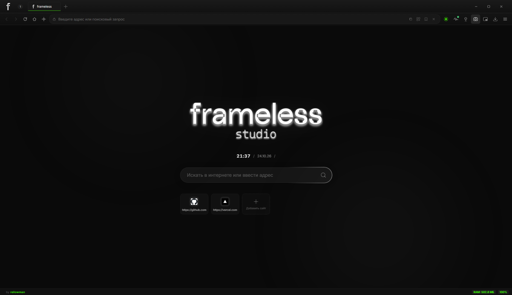
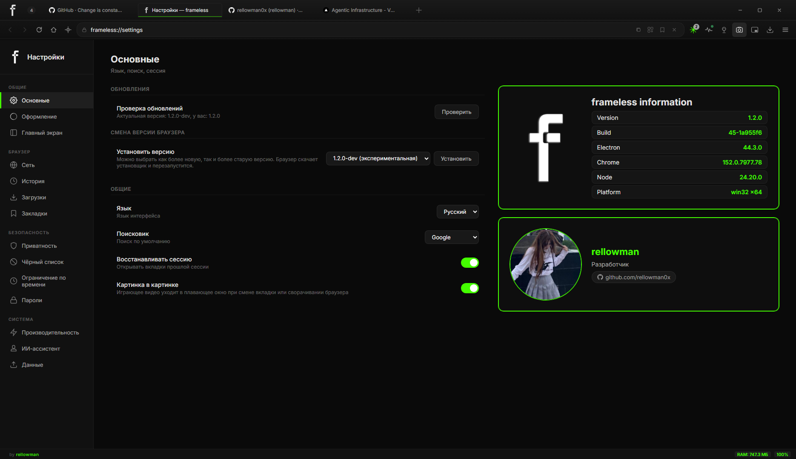

# frameless

  

**frameless** — быстрый, тёмный, минималистичный веб-браузер для Windows, созданный на базе Electron (Chromium).

> ⚠️ **Проприетарное программное обеспечение.** Исходный код проекта закрыт и не публикуется в этом репозитории. Репозиторий используется для релизов, документации и отслеживания ошибок.

## Возможности

- **Блокировка рекламных кликандеров** — сайты не могут открывать пустые вкладки при клике по странице; рекламные домены блокируются на уровне браузера.
- **Менеджер паролей** — сохранение и автозаполнение паролей; просмотр пароля защищён подтверждением через Windows Hello (лицо, отпечаток или PIN).
- **Режим инкогнито** — история, вкладки и загрузки не сохраняются.
- **Картинка в картинке (PiP)** — видео открывается в отдельном плавающем окне поверх других.
- **Загрузки** — выбор папки для загрузок, выборочное сохранение через диалог «Сохранить как», предпросмотр скачанных изображений и видео.
- **Автообновление** — браузер проверяет новые релизы на GitHub и предлагает обновиться; поддерживаются теги `dev` (экспериментальные версии) и `dont` (не предлагать обновление), а также ручная смена версии в настройках.
- **Импорт данных** — перенос закладок и настроек из Chrome и Яндекс.Браузера при первом запуске.
- **Паки иконок** — несколько вариантов иконки браузера на выбор в настройках.
- **Стартовая страница** — поиск с подсказками, погода, определение города.
- **Встроенный ИИ-ассистент (опционально)**: GPT-4o/Gemini, распознавание речи (Whisper) и синтез голоса (Edge TTS). Требует собственный API-ключ OpenAI/Gemini
- Вкладки, закладки с папками, история, восстановление сессии, горячие клавиши, страница настроек по адресу `frameless://settings`.

## Требования

- Windows 10 / 11 (x64)

## Установка

1. Перейдите в раздел [Releases](../../releases).
2. Скачайте `frameless-Setup-x.x.x.exe`.
3. Запустите установщик и следуйте инструкциям.

> **Примечание.** Установщик не имеет цифровой подписи, поэтому антивирусы (Defender, Kaspersky и др.) могут выдавать предупреждение. Это ложное срабатывание. Скачивайте файлы только из официальных релизов этого репозитория.

## Обновление

Браузер проверяет обновления автоматически и предлагает скачать новый установщик с GitHub. Обновить можно и вручную — просто установите свежий релиз поверх старой версии.

## Безопасность и приватность

- Пароли хранятся локально на вашем компьютере; их просмотр защищён Windows Hello.
- Режим инкогнито не сохраняет историю, вкладки и загрузки.
- Браузер не отправляет телеметрию.
- Опциональный ИИ-ассистент обращается к OpenAI/Gemini только по вашему собственному API-ключу и только когда вы им пользуетесь.

## Скриншоты

<!-- TODO: добавьте скриншоты в папку screenshots/ и раскомментируйте -->

<!--  -->
<!--  -->
<!--  -->

## Поддержка и обратная связь

Нашли баг или есть идея по улучшению? Создайте [Issue](../../issues) — опишите проблему, версию браузера (видна в настройках) и шаги для воспроизведения.

## Лицензия

Copyright © 2026 rellowman. Все права защищены.

Разрешается свободное использование браузера в личных некоммерческих целях. Запрещено распространение, модификация и использование в коммерческих продуктах без разрешения автора.
